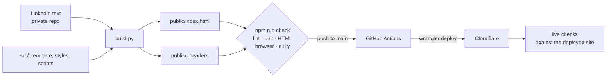

# kazuhoshibuya.com

[](https://github.com/kazuho-shibuya/kazuhoshibuya.com/actions/workflows/check.yml)

My personal site, live at **[kazuhoshibuya.com](https://kazuhoshibuya.com)**: one static page, generated from the same text as my LinkedIn profile, tested in three browsers and served from Cloudflare. Built with Claude Code from plans I wrote and reviewed.

## How it fits together



```
src/template.html          the page's markup and the text that belongs to the site itself
src/styles.css, *.js       styles and the two small scripts, written separately and inlined by the build
scripts/build.py           fills the template from the LinkedIn text; writes public/index.html and public/_headers
scripts/subset-jp-font.sh  rebuilds the Japanese font with only the characters the page uses
public/                    the built page, its headers file and self-hosted fonts (generated, committed)
tests/                     unit tests for the build, browser tests by concern, approved screenshots
deploy.sh                  every check, deploy, then the browser checks against the live site
```

## Decisions and their trade-offs

| Decision                                                   | Why                                                                                                                                            | What it costs                                                                                |
| ---------------------------------------------------------- | ---------------------------------------------------------------------------------------------------------------------------------------------- | -------------------------------------------------------------------------------------------- |
| The words are generated from my LinkedIn text              | One source of truth: the site cannot say something LinkedIn does not, and the build fails if a section or a selected highlight disappears      | The source is private, so a wording change is built on my machine, not in CI                 |
| The built page is committed                                | CI cannot read the private source, so it tests and deploys exactly the file that was reviewed                                                  | Generated output in git; `build.py` is the only writer, and the live check catches drift     |
| No framework, no cookies                                   | One page needs HTML, CSS and two small scripts; nothing to update, nothing to break                                                            | Layout and motion are hand-written CSS                                                       |
| CSP by hash, never `unsafe-inline`                         | `build.py` hashes each inline script and style block into `_headers`, so the policy allows exactly this page's code and is regenerated with it | Any inline code that is not in the built page is blocked, including tools that inject styles |
| Screenshots compared on the Mac only                       | No pixel may differ beyond a 5% colour tolerance, so any layout or spacing change fails                                                        | Linux renders fonts differently, so CI cannot run it; it runs before every local deploy      |
| Motion only where supported, and never with reduced motion | Scroll-driven CSS animation needs no JavaScript; browsers without it, such as Firefox, show the finished state                                 | Firefox visitors do not see the route draw itself                                            |

## Testing strategy

Each layer catches a different class of mistake. `npm run check` runs them in this order, and GitHub Actions runs the same before every deploy.

| Layer         | Tool                                | Catches                                                                                                                                                            |
| ------------- | ----------------------------------- | ------------------------------------------------------------------------------------------------------------------------------------------------------------------ |
| Lint          | Ruff, Prettier                      | style drift and simple bugs in the scripts and tests                                                                                                               |
| Unit          | `unittest`, made-up fixture         | parsing and rendering mistakes in `build.py`, without the private source                                                                                           |
| HTML          | html-validate                       | invalid or inaccessible markup                                                                                                                                     |
| Browser       | Playwright: Chrome, WebKit, Firefox | overflow, wrapped lines and sizes off the type scale at 12 screen widths from 320 to 1920px, console errors, links, fonts, motion, the theme switch, the copy link |
| Accessibility | axe-core                            | WCAG 2.1 AA violations in light and dark mode                                                                                                                      |
| Security      | Playwright + `_headers`             | inline code not covered by the policy, and headers missing from the live response                                                                                  |
| Visual        | Playwright screenshots              | any pixel that changed by more than a 5% colour tolerance without being approved                                                                                   |
| Live          | the browser suite, `LIVE=1`         | anything that differs once deployed: caching, headers, the CDN                                                                                                     |

An element that must never wrap, such as the footer, carries `data-one-line`, and one test checks every such element at every width.

Two tests have notes worth knowing. The wave-overlap check bypasses the CSP, because it hides the wave with an injected style. On live runs, Firefox's dark mode is checked through its own OS-theme preference, because Playwright's colour-scheme emulation does not survive the process switch that `Cross-Origin-Opener-Policy` causes in Firefox.

## Working on it

Test first: write the test that describes the change, watch it fail for the right reason, make the smallest change that passes, then run `npm run check`.

```sh
npm ci && npx playwright install webkit firefox   # Node 24, Python 3, uv, Google Chrome
npm run check                                              # everything, in the order above
npm run format                                             # Ruff and Prettier
```

| Change                 | Edit                                              | Then                                                                                |
| ---------------------- | ------------------------------------------------- | ----------------------------------------------------------------------------------- |
| Words                  | the LinkedIn text in the private repo             | `./deploy.sh`                                                                       |
| Layout, styles, design | `src/template.html`, `src/styles.css`, `src/*.js` | `npm run build`; review the screenshots; `npm run screenshots:update` once approved |
| Japanese text          | `src/template.html`                               | `scripts/subset-jp-font.sh`; a test fails if a character has no glyph               |
| Build logic            | `scripts/build.py`                                | `npm run test:unit`                                                                 |

Push to `main` to deploy: GitHub Actions runs every check, deploys with `wrangler` using the `CLOUDFLARE_API_TOKEN` repository secret, waits for the new version, then runs the browser suite against the live site. Dependabot proposes dependency updates weekly.

## Licence

Code under MIT; content and design reserved; fonts under the SIL Open Font License. See [LICENSE](LICENSE).
